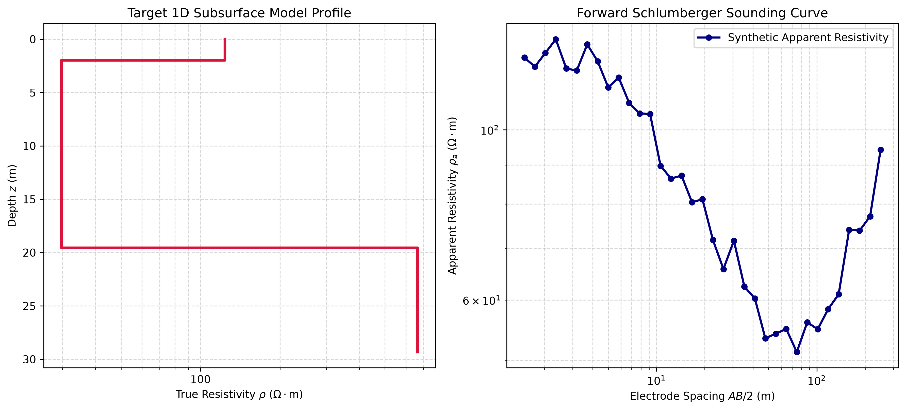

# 1D Subsurface Electrical Resistivity Forward & Non-Linear Inversion Modeling

A modular Python framework for simulating and inverting 1D vertical electrical sounding (VES) data using the Schlumberger array configuration. This package implements digital linear filtering for fast forward response calculations and non-linear least-squares optimization for parameter recovery under noisy field conditions.

---

## 📌 Features

- **Forward Simulation**: Uses Guptasarma's 10-point digital linear filter algorithm to compute apparent resistivity responses over arbitrary $n$-layered Earth models.
- **Synthetic Field Noise**: Injects realistic Gaussian relative noise ($\sigma = 5\%$) to simulate real-world field measurement uncertainties.
- **Non-Linear Inversion Engine**: Implements the Levenberg-Marquardt optimization method (`scipy.optimize.least_squares`) in logarithmic parameter space to enforce parameter positivity and recover true layer resistivities ($\rho$) and thicknesses ($h$).
- **Data Export & Visualization**: Exports simulated sounding curves to structured CSV format and plots dual-panel publication-ready figures (Subsurface Layer Profile vs. Sounding Curve).

---

## 🧮 Mathematical Formulation

### Forward Problem (Linear Filtering Theory)
For a Schlumberger array with electrode half-spacing $s = AB/2$, the apparent resistivity $\rho_a(s)$ is computed via the Hankel transform integral:

$$\rho_a(s) = \sum_{k=1}^{N} T(\lambda_k) \cdot f_k$$

Where:
- $f_k$ represents the Guptasarma (1979) filter weights evaluated at logarithmic sampling locations $\lambda_k = 10^{\text{shift}_k} / s$.
- $T(\lambda)$ is the resistivity transform function calculated recursively from the bottom infinite half-space layer $n$ up to the surface layer 1:

$$T_i(\lambda) = \frac{T_{i+1}(\lambda) + \rho_i \tanh(\lambda h_i)}{1 + \frac{T_{i+1}(\lambda)}{\rho_i} \tanh(\lambda h_i)}$$

### Inverse Problem (Levenberg-Marquardt Least-Squares)
The objective function minimizes the logarithmic relative misfit between observed field data $\mathbf{d}_{\text{obs}}$ and predicted response $\mathbf{d}_{\text{pred}}(\mathbf{m})$:

$$\Phi(\mathbf{m}) = \left\Vert{} \ln(\mathbf{d}_{\text{obs}}) - \ln(\mathbf{d}_{\text{pred}}(\mathbf{m})) \right\Vert{}_2^2$$

Optimization is performed over transformed log-parameters $\mathbf{m} = [\ln(\mathbf{\rho}), \ln(\mathbf{h})]^T$.

---

## 📁 Repository Structure

```text
resistivity-1d-inversion/
│
├── data/
│   └── sounding_data.csv    # Exported synthetic sounding curve
│
├── src/
│   ├── __init__.py
│   ├── forward_model.py     # Guptasarma 10-point forward engine & noise generator
│   ├── inversion.py         # Levenberg-Marquardt optimization solver
│   ├── visualize.py         # Publication-grade plotting routines
│   └── exporter.py          # Data export utility
│
├── main.py                  # Pipeline execution script
├── requirements.txt         # Project dependencies
├── .gitignore
└── README.md                # Documentation

### Visual Output

