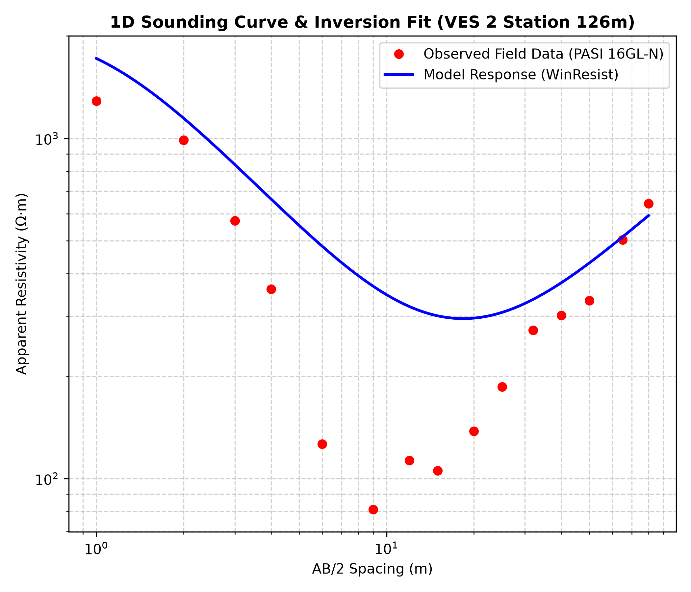
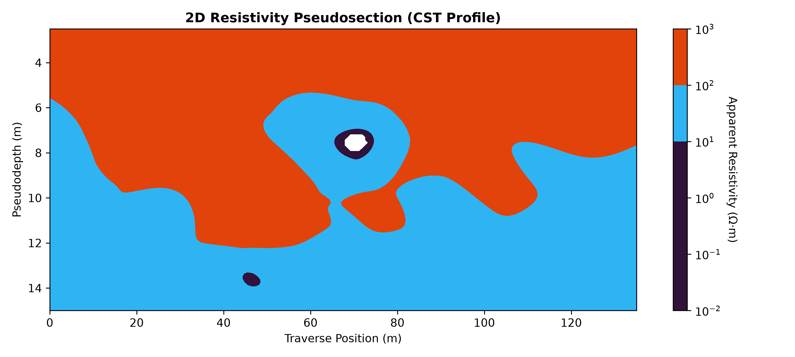
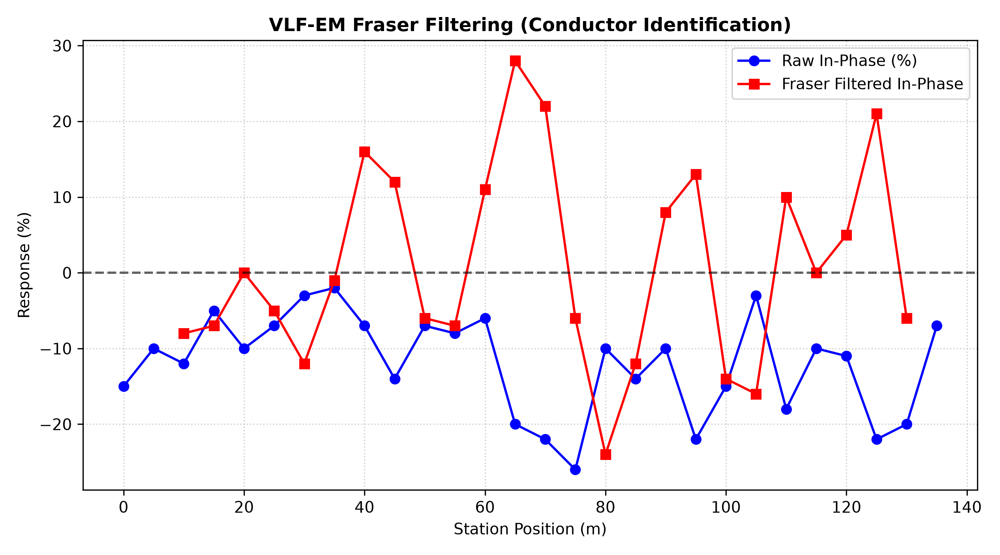

# Integrated Geophysical Analysis Suite (Eruwa Site)

An integrated Python data processing and computational geophysics suite developed for mapping subsurface lithology, bedrock topography, and groundwater potential in basement complex terrains. This package processes field data acquired at the Eruwa Basement Complex site in Southwestern Nigeria, combining 2D Electrical Resistivity Profiling (CST), 1D Vertical Electrical Sounding (VES), and Very Low Frequency Electromagnetic (VLF-EM) filtering.

---

## 📌 Key Features

* **2D CST Resistivity Pseudosections:** Interpolates multi-spacing Wenner array profiling data ($a = 10\text{m} - 60\text{m}$) into continuous logarithmic 2D resistivity cross-sections across a 200m traverse.
* **VLF-EM Fraser Filtering:** Executes a 4-point digital Fraser filter algorithm on raw In-Phase and Quadrature field measurements to highlight conductive fracture zones and structural discontinuities.
* **1D VES Forward Modeling:** Simulates Schlumberger apparent resistivity curves using digital linear filter theory and matches field curves directly against commercial WinResist inversion parameters.
* **Modular Codebase:** Cleanly organized inside `src/` modules for electrical, electromagnetic, modeling, and visualization tasks, executed via a single pipeline script (`run_pipeline.py`).

---

## 📐 Field & Modeling Methodology

### 1. Constant Separation Traversing (CST)
* **Configuration:** Wenner Array ($a = 10\text{m}, 20\text{m}, 30\text{m}, 40\text{m}, 50\text{m}, 60\text{m}$)
* **Traverse Length:** 200 m (21 measurement stations at 10 m spacing)
* **Target:** Delineating lateral resistivity contrasts between shallow resistive basement ridges ($0\text{m} - 80\text{m}$) and deeply weathered conductive troughs ($115\text{m} - 145\text{m}$).

### 2. Vertical Electrical Sounding (VES)
* **Configuration:** Schlumberger Array ($AB/2$ up to 80m)
* **Primary Target:** Station 126m (VES 2)
* **Geoelectric Interpretation:** Classic H-Type curve ($\rho_1 > \rho_2 < \rho_3$) revealing an 8.8m thick saturated weathered aquifer ($\rho_2 = 76.5\,\Omega\cdot\text{m}$) overlying fresh bedrock ($\rho_3 = 2914\,\Omega\cdot\text{m}$).

### 3. VLF-EM Filtering
* **Filter Algorithm:** 4-Point Digital Fraser Filter
  $$F_{2,3} = (q_3 + q_4) - (q_1 + q_2)$$
* **Objective:** Converting inflections into positive peaks to locate vertical conductive fractures and subsurface shear zones.

---

## 📸 Sample Visualizations

### 1D Sounding Fit vs. WinResist Model (Station 126m)


### 2D CST Resistivity Pseudosection


### VLF-EM Fraser Filtered Profile


---

## 🚀 Getting Started

### 1. Clone the Repository
```bash
git clone [https://github.com/TheABZ/geophysical-eruwa-suite.git](https://github.com/TheABZ/geophysical-eruwa-suite.git)
cd geophysical-eruwa-suite
